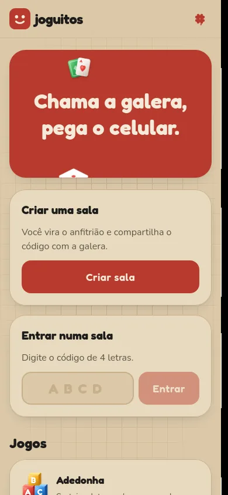
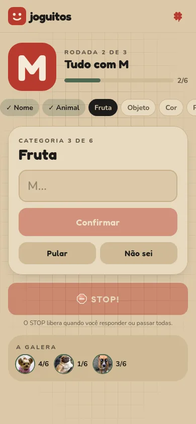
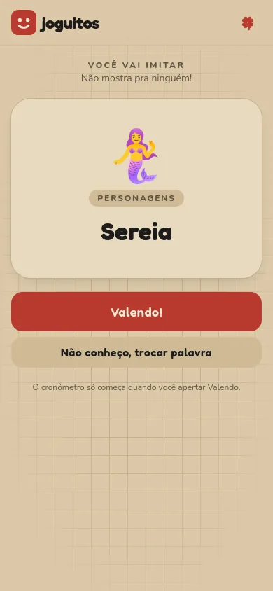
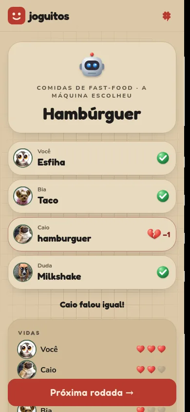

# joguitos

**Jogos de festa pra jogar junto, cada um no seu celular.**
Sem instalar nada e sem cadastro: alguém cria a sala, a galera entra com um código de 4 letras e a diversão acontece na roda.

   

## Jogos

- **Adedonha:** sai a letra, cada um preenche as categorias e alguém grita STOP.
- **Mímica Relâmpago:** um imita, a galera chuta no celular.
- **Não Fale o Mesmo que Eu:** todo mundo responde ao mesmo tempo, quem falar igual perde uma vida.

---

Feito com carinho por [@rugalbless](https://github.com/rugalbless) · [Licença MIT](LICENSE)

